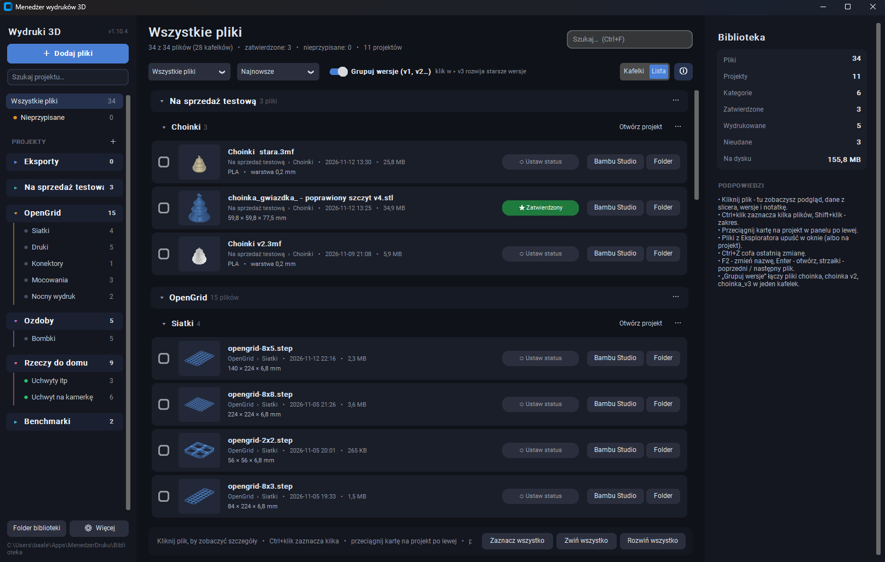
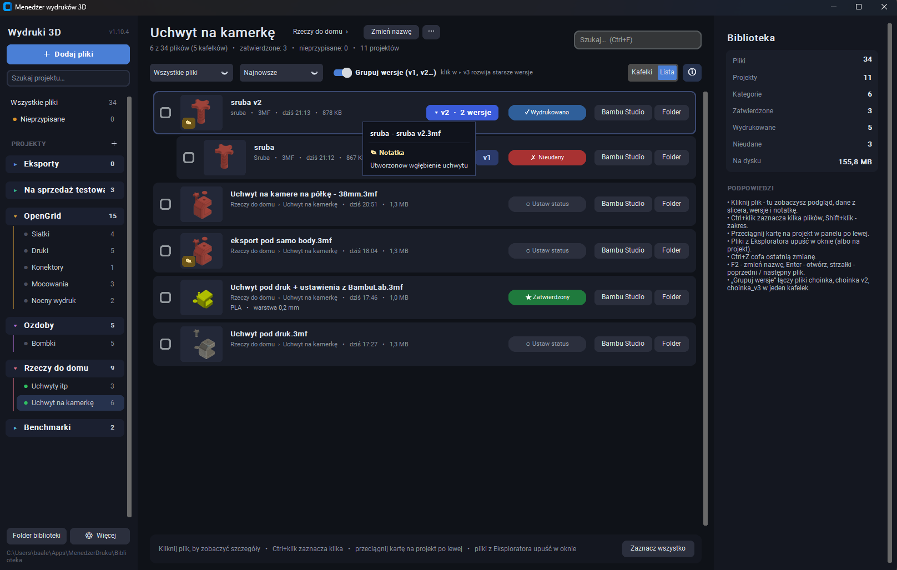
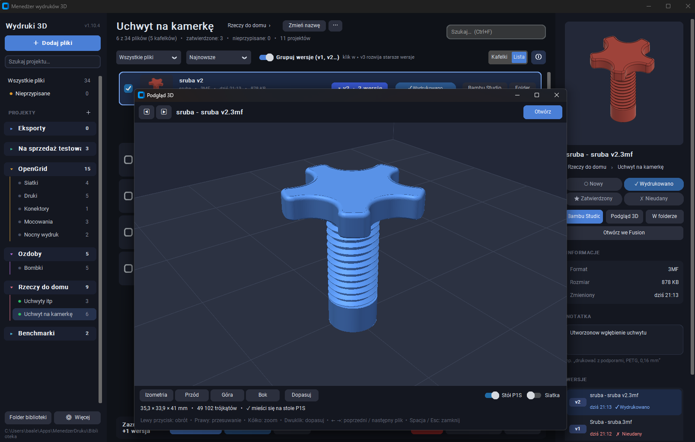

# Menedżer wydruków 3D

**Porządek w plikach do druku 3D: projekty, wersje, statusy wydruków i dodatek do Autodesk Fusion.**

Windows 10 / 11 · darmowy · aktualizuje się sam

[**⬇ Pobierz instalator**](https://github.com/Baalek/menedzer-druku-wydania/releases/latest)

  

---

## Po co to?

Każdy, kto projektuje swoje rzeczy i drukuje je w domu, zna ten bałagan: folder z dziesiątkami plików `uchwyt.stl`, `uchwyt2.stl`, `uchwyt_final.3mf`, `uchwyt_final_NAPRAWDE.3mf`... i po miesiącu nikt nie wie, która wersja była dobra, a która się wypaczyła.

Menedżer trzyma wszystkie pliki w jednej bibliotece, poukładane w **kategorie i projekty**, łączy kolejne **wersje** jednego modelu i pamięta, **co zostało wydrukowane, co jest sprawdzone, a co nie wyszło**.

Najwięcej daje przy własnych projektach z **Autodesk Fusion** i drukarkach **Bambu Lab**, ale działa z każdymi plikami STL / 3MF / STEP.

## Co umie

### 📁 Biblioteka
- Kategorie i projekty w panelu po lewej. Układasz je przeciąganiem, kategorie można zwijać.
- Pliki dodajesz przyciskiem albo przeciągając je (także całe foldery) z Eksploratora.
- Program sam układa pliki na dysku (`Biblioteka\Kategoria\Projekt\plik`). To zwykłe foldery, więc nic nie jest zamknięte w żadnej bazie.
- Obserwowany folder: nowe pliki (np. z Pobranych) program wykrywa i proponuje do importu.
- Widok kafelków z dużymi podglądami albo zwarta lista. Do tego wyszukiwarka (szuka też w notatkach), filtry i sortowanie.

### 🔢 Wersje
- `choinka`, `choinka v2`, `choinka_v3` to jeden wpis z drzewkiem wersji. Najnowsza jest na wierzchu, starsze rozwijasz kliknięciem.
- Program **nie zmienia nazw plików sam**. Numer wersji dopisujesz, kiedy chcesz, a okno go podpowiada.
- Identyczny plik wysłany drugi raz nie robi duplikatu, bo program porównuje geometrię.

### ✅ Statusy i notatki
- Każda wersja ma jeden status: **Nowy · Wydrukowano · Zatwierdzony ★ · Nieudany**.
- Notatka przy pliku („PETG, podpory, 0,16 mm”, „pękło przy zawiasie”) widoczna w dymku po najechaniu.
- Czas druku i ilość filamentu odczytane z plików .3mf / .gcode, z sumą dla całego projektu.

  

### 🧊 Podgląd 3D
Nie trzeba otwierać slicera, żeby sprawdzić, co jest w pliku.

- **Miniatury na każdym pliku**: dla STL, 3MF, STEP, G-code i FreeCAD (.FCStd). Pliki STL i STEP program rysuje sam jako cieniowany model, a gotowe miniatury wyciąga z plików 3MF i G-code. Podglądy liczą się raz i są zapamiętywane, więc lista działa szybko.
- **Okno Podgląd 3D pokazuje pliki STL, 3MF i STEP** jako prawdziwy model, który można obracać. Otwierasz je **Spacją**, przyciskiem „Podgląd 3D” albo kliknięciem w duży podgląd w panelu szczegółów:
  - model stoi na stole drukarki (**Stół P1S**, 256 × 256 mm z obrysem przestrzeni roboczej),
  - **lewy przycisk** obraca, **prawy** przesuwa, **kółko** przybliża, **dwuklik** dopasowuje widok,
  - gotowe widoki: **Izometria, Przód, Góra, Bok**,
  - przełącznik **Siatka** pokazuje trójkąty modelu,
  - na dole: **wymiary** (np. 35,3 × 33,9 × 41 mm), liczba trójkątów i informacja, czy model **mieści się na stole** (na pomarańczowo, gdy nie),
  - strzałki **← →** przechodzą do poprzedniego i następnego pliku, więc szybko przejrzysz cały projekt, a okno idzie za zaznaczeniem w głównym oknie,
  - przycisk **Otwórz** od razu przenosi plik do Bambu Studio.
- Pliki 3MF z kilkoma obiektami są ułożone tak jak w slicerze, a nie zwalone jeden na drugi.
- Pliki **STEP** przelicza wbudowany silnik CAD (OpenCascade), więc nie potrzebujesz żadnego dodatkowego programu.

  

### 🔒 Bezpiecznie
- **Ctrl+Z** cofa prawie każdą zmianę (przeniesienie, zmianę nazwy, status, usunięcie).
- „Usuń” przenosi pliki do kosza programu na 30 dni, skąd można je przywrócić.
- Aktualizacje instalują się same z tej strony. Po aktualizacji program pokazuje, co się zmieniło.

## 🛠️ Dodatek do Autodesk Fusion: „Wyślij do managera”

To najważniejsza część programu, jeśli projektujesz sam. Bez dodatku eksport wygląda tak: *Plik → Eksportuj → wybierz format → wybierz folder → wpisz nazwę → przenieś plik tam, gdzie trzymasz projekt*. Do tego przy modelu z kilku części trzeba wyeksportować całość, rozdzielić ją w slicerze, a po poprawce jednej części robić to wszystko od nowa.

Z dodatkiem klikasz jeden przycisk we Fusion, a plik ląduje w managerze, we właściwym projekcie, z kolejnym numerem wersji.

### Jak to wygląda
1. We Fusion na karcie **SOLID** pojawia się panel **MANAGER** z przyciskiem **Wyślij do managera**.
2. Otwiera się okno, w którym:

| Pole | Co robi |
|---|---|
| **Bryły** | Kliknij w modelu bryły, które mają trafić do pliku, np. obie części zawiasu. Bez zaznaczenia idzie cały model (widoczne bryły). Bryły zaznaczone przed kliknięciem przycisku wskakują tu same. |
| **Projekt** | Projekt w managerze, do którego trafi plik. Fusion pamięta, gdzie wysyłałeś dany model. Nowy model domyślnie idzie do kategorii **Eksporty**, skąd po udanym wydruku przenosisz go, gdzie chcesz. |
| **Nazwa pliku** | Podpowiada kolejną wersję (np. `uchwyt v3`, gdy w projekcie są v1 i v2) i ostrzega, gdy taka nazwa już jest. |
| **Zmiany** | Krótko, co poprawiłeś („grubsza ścianka przy śrubie”). Tekst staje się notatką pliku w managerze. |
| **STL / 3MF / STEP** | Formaty do zapisania, w dowolnym połączeniu. Okno pamięta wybór. W 3MF bryły zostają osobnymi obiektami, nie są zlepione. |
| **Osobno** | Każda bryła idzie do osobnego pliku (`imadło - korpus`, `imadło - pokrętło`) z własną historią wersji. Dodatek pamięta kształt każdej wysłanej bryły i przy kolejnym wysłaniu **sam zaznacza tylko te, które się zmieniły** („zmieniona”, „nowa”, „bez zmian”). |
| **Komplet** | W trybie „Osobno”: dodatkowo jeden 3MF z wszystkimi bryłami naraz. |

3. Klikasz **Wyślij**. Manager w ciągu 2 sekund dodaje pliki, otwiera projekt, zaznacza nowe pliki i pokazuje dymek z przyciskiem „Cofnij”. Jeśli manager jest zamknięty, dodatek go uruchamia, a pliki czekają na niego w skrzynce.

### Przykład z życia
Projektujesz uchwyt z trzech części. Pierwszy raz wysyłasz go w trybie **Osobno**: w managerze powstają trzy pliki v1. Drukujesz, jedna część pęka. Poprawiasz ją we Fusion i znowu klikasz **Wyślij do managera**. Dodatek sam zaznacza tylko poprawioną część, więc w managerze pojawia się jej v2, a dwie pozostałe zostają bez zmian. Starą wersję oznaczasz jako **Nieudany** z notatką, co pękło.

### W drugą stronę
Przy plikach wysłanych z Fusion manager ma przycisk **„Otwórz we Fusion”**, który otwiera model, z którego plik powstał. Jeśli Fusion jest zamknięty, prośba czeka 15 minut i model otworzy się po jego uruchomieniu.

### Dobrze wiedzieć
- Dodatek **nie zmienia niczego w Twoim projekcie we Fusion**. Tylko eksportuje.
- Nazwij bryły we Fusion (zamiast `Body1`, `Body2`). Te nazwy trafiają do nazw plików. Dodatek ostrzega, gdy zostały domyślne.
- Bez zaznaczenia brył eksportują się tylko widoczne, więc ukryj to, czego nie chcesz w pliku.
- Działa na darmowej licencji Fusion Personal, bo na takiej powstał.

## Instalacja

1. Pobierz `MenedzerDruku-Setup.exe` z [Releases](https://github.com/Baalek/menedzer-druku-wydania/releases/latest) i uruchom.
   > Windows może pokazać ostrzeżenie **„System Windows ochronił ten komputer”**, bo instalator nie ma płatnego certyfikatu wydawcy. Kliknij **Więcej informacji → Uruchom mimo to**.
2. Instalator nie wymaga uprawnień administratora. Program trafia do `%LOCALAPPDATA%\Programs\MenedzerDruku` i jest widoczny w *Ustawienia → Aplikacje*, skąd można go normalnie odinstalować.
3. Biblioteka domyślnie leży w `C:\Users\<ty>\Apps\MenedzerDruku\Biblioteka`. Możesz to zmienić w **Więcej… → Zmień lokalizację biblioteki…**
4. Masz już folder pełen wydruków? **＋ Dodaj pliki → Importuj starą bibliotekę…** zabierze z niego (i z podfolderów) wszystkie pliki 3D. Do wyboru masz kopiowanie albo przeniesienie. Pliki trafiają do „Nieprzypisanych”, a pojedynczy folder od razu jako projekt dodasz przez **＋ Dodaj pliki → Folder…** albo przeciągając go do okna.

**Dodatek do Fusion** (opcjonalnie): w managerze kliknij **Więcej… → Dodatek do Fusion… → Zainstaluj dodatek**, a potem jednorazowo we Fusion **UTILITIES → ADD-INS → Scripts and Add-Ins → ＋ → Script or add-in from device**. Okno w managerze prowadzi krok po kroku. Później dodatek aktualizuje się razem z programem.

**Bambu Studio** (opcjonalnie): program sam szuka go w typowych miejscach. Jeśli go nie znajdzie, wskaż go w **Więcej… → Bambu Studio – wskaż program…**

## Gdzie są moje dane?

Wszystko leży w zwykłych folderach w bibliotece. Przypisania, statusy i notatki zapisuje plik `manifest.json` w tym samym folderze. Żeby zrobić kopię zapasową, wystarczy skopiować cały folder biblioteki. W programie: **Więcej… → Gdzie są moje pliki?**

Program nie wysyła nigdzie żadnych danych. Jedyne połączenie z internetem to sprawdzenie, czy jest nowa wersja.

## O projekcie

To **hobbystyczny projekt jednej osoby**, zrobiony najpierw dla siebie: do porządkowania własnych projektów z Fusiona drukowanych na Bambu Lab P1S. Kod powstał przy dużej pomocy AI (Claude). Program jest rozwijany w moim wolnym czasie i w moim tempie.

- Używasz na własną odpowiedzialność. Zrób kopię ważnych plików, zanim wrzucisz je do biblioteki.
- Błędy i pomysły zgłoś w [Issues](https://github.com/Baalek/menedzer-druku-wydania/issues). Chętnie przeczytam, ale nie obiecuję terminów.
- Interfejs jest na razie tylko po polsku.

Historia zmian: opis przy [najnowszym wydaniu](https://github.com/Baalek/menedzer-druku-wydania/releases/latest), a w programie **Więcej… → Co nowego**.

---

🇬🇧 English summary

**3D Print Manager** is a free Windows app for organizing 3D printing files (STL, 3MF, STEP, G-code, FreeCAD) into categories and projects, grouping file versions into a tree, and tracking print status (New / Printed / Approved / Failed) with notes, print time and filament usage read from .3mf/.gcode files. It includes a 3D preview with a build-plate fit check and an **Autodesk Fusion add-in** that exports selected bodies, or each body separately with change detection, straight into the manager. One-click "Open in Bambu Studio" / "Open in Fusion", an app trash, undo for nearly everything, and automatic updates.

It's a one-person hobby project, built largely with the help of AI (Claude). The UI is Polish-only for now. Feedback is welcome in Issues.

